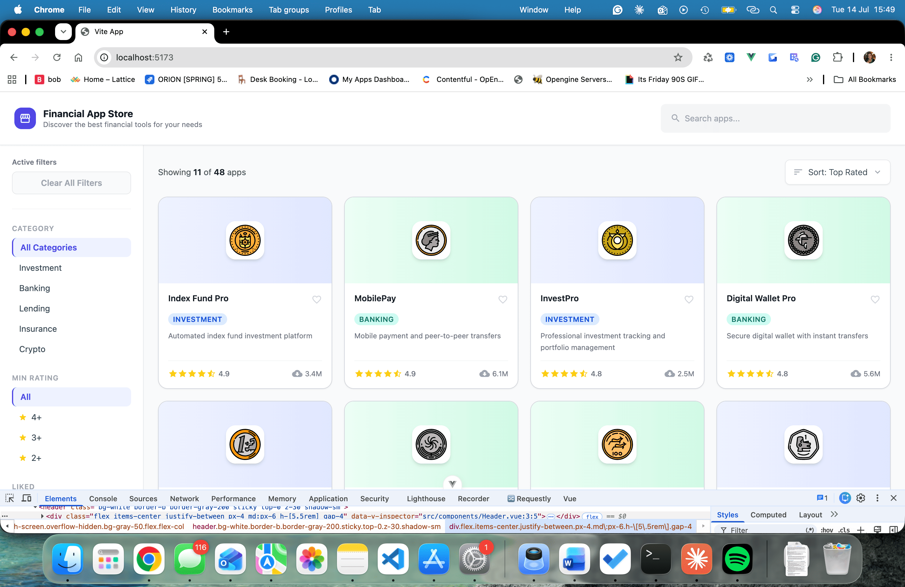
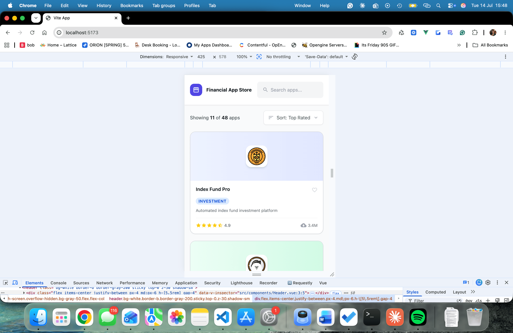

# my-app - # Financial App Store — Frontend Application

### Recommended IDE Setup
* [VS Code](https://visualstudio.com) + [Vue - Official Extension](https://visualstudio.com) (Please disable Vetur to avoid conflicts).

### Project Installation
Clone the repository and install the dependencies:
```bash
npm install
```

### Development Server
Run the local development server (typically available at `http://localhost:5173`):
```bash
npm run dev
```
## Screenshots of the finished app

- Desktop Layout



- Mobile Responsive Layout



## 🛠️ Tech Stack & Architecture

* **Framework:** Vue 3 (Composition API)
* **Styling:** Tailwind CSS (Utility-first, responsive grid layout)
* **Icons & Assets:** Optimised SVGs integrated with Google Material Icons for visual consistency


## ✨ Core Features & Evaluation Criteria

* **Design Fidelity:** Meticulously matched to the provided design specifications, focusing on exact spacing, typography hierarchy, and clean alignments.
* **Component Workflow:** Implemented responsive layouts with smooth hover states and intuitive element interactions.
* **Asset Optimisation:** All SVG icons have been manually optimised to reduce bundle size and asset loading times.
* **Development Efficiency:** Utilised advanced AI scaffolding and debugging techniques to accelerate UI styling and structural layout creation.

---

## 🔮 Roadmap & Future Improvements

While this version represents a complete, functional UI iteration, the following features are planned for future releases to make the codebase enterprise-ready:

* **Advanced Filtering & State:** Implement comprehensive search filtering, multi-select "Clear All" functionality, and dynamic sorting algorithms.
* **Enhanced Mobile UX:** Expand the mobile layout to include a dedicated drawer/hamburger menu for advanced filtering workflows.
* **Scalable Architecture:** Refactor components using **Atomic Design** principles to establish a single source of truth for engineering and design teams.
* **Quality Assurance:** Introduce ESLint configurations, comprehensive unit testing suites, and robust global error boundary handling.
* **Accessibility (a11y):** Improve ARIA attributes, semantic HTML tags, and full keyboard navigation patterns.
